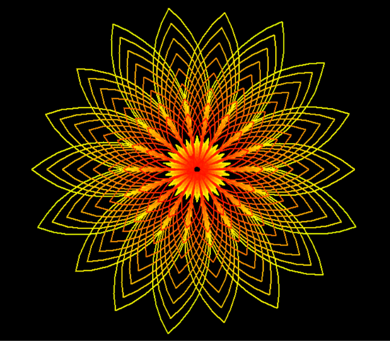

# 🌻 Blooming for Val

*A little flower, drawn with colors and love.*

A creative Python project that uses Turtle Graphics and mathematical curves to generate a colorful floral illustration.

Through repeated circular movements, geometric transformations, and dynamic color variations, the script gradually creates a flower-like composition.

A little digital bloom, made especially for Val. ♡

---

## 💗 Graphical Representation

### The final result



### 🎬 Animation preview

Watch the flower bloom through the drawing process:

[▶ Watch the animation — sunflower.mp4](graphical-representation/sunflower.mp4)

---

## ✨ About the project

This project explores the use of mathematical curves and geometric transformations to create generative art using Python.

The Turtle Graphics library is used to draw a sequence of circular arcs, while rotations and HSV color transformations produce the final colorful floral pattern.

### Features

- 🌻 Procedural floral illustration.
- 🎨 Dynamic rainbow color generation using HSV.
- 🌀 Circular curves and geometric transformations.
- 🐢 Animated drawing with Python Turtle.
- 🌈 Progressive color variation throughout the composition.
- 💛 A little flower created with love for Val.

---

## 🛠️ Built with

- **Python 3**
- **Turtle Graphics** — Drawing and geometric transformations.
- **Colorsys** — HSV to RGB color conversion.
- **Math / Geometry** — Circular curves and rotational movements.

---

## 📂 Project structure

```text
blooming-for-val/
│
├── main.py
├── README.md
│
└── graphical-representation/
    ├── sunflower.png
    └── sunflower.mp4
```

| File | Description |
|---|---|
| `main.py` | Main script responsible for generating the floral illustration. |
| `graphical-representation/sunflower.png` | Screenshot of the final illustration. |
| `graphical-representation/sunflower.mp4` | Video showing the flower being drawn. |
| `README.md` | Project documentation. |

---

## 🚀 Getting started

### Requirements

- Python 3.x
- Tkinter support for Python Turtle.

### Installation

Clone the repository:

```bash
git clone https://github.com/laetg404/blooming-for-val.git
```

Navigate to the project directory:

```bash
cd blooming-for-val
```

Run the script:

```bash
python main.py
```

---

## ⚙️ How it works

1. Initializes the Turtle drawing environment.
2. Sets the background color and drawing speed.
3. Initializes the HSV color value.
4. Iterates through 200 drawing cycles.
5. Converts HSV values into RGB colors.
6. Draws circular arcs using the `circle()` function.
7. Applies rotations to create the floral geometry.
8. Updates the color progressively to produce a colorful composition.

---

## ♡ A little dedication

Flowers don't always need soil, sunlight, or water to bloom.

Sometimes, all they need is a little imagination, a few lines of code, and someone special to inspire them.

**This little flower is for you, Valbb. Always. ♡**

---

<sub>Part of a collection of little projects created with love.</sub>

🌻
